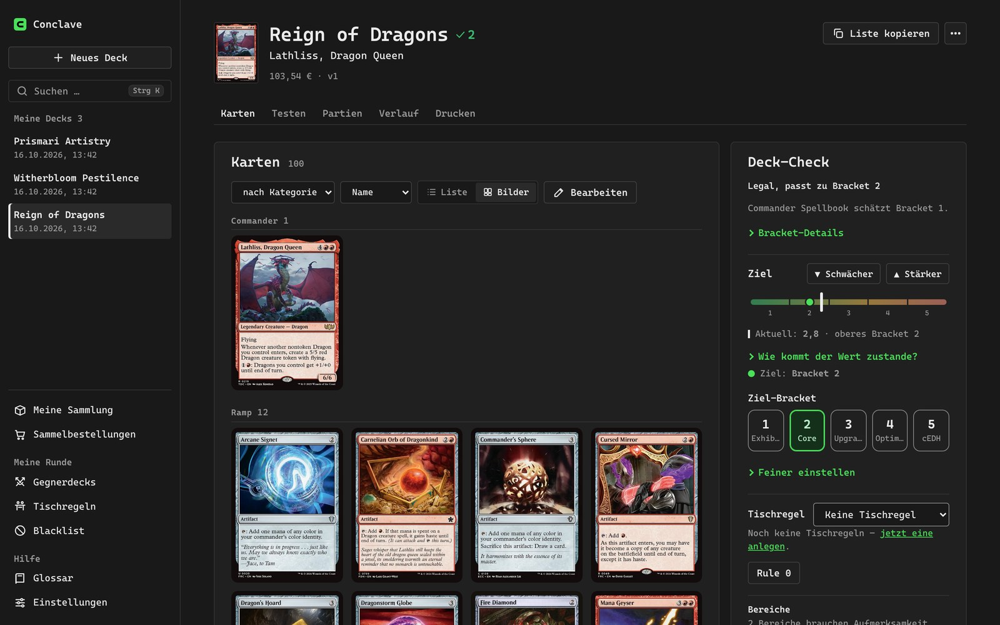

<p align="center">
  <picture>
    <source media="(prefers-color-scheme: light)" srcset="docs/images/banner-light.jpg">
    
  </picture>
</p>

<p align="center">
  <a href="https://github.com/liehrdot/Conclave/releases/latest"></a>
  <a href="https://github.com/liehrdot/Conclave/actions/workflows/tests.yml"></a>
  
</p>

# Conclave

**Conclave is my own Commander deckbuilder for Magic: The Gathering.** I build my decks myself, and Conclave
takes care of the boring parts: it looks up cards, checks the rules and the power level, keeps every version
of a deck, lets me draw test hands, prints proxies and keeps my PC, phone and iPad in sync.

## Why this exists

Conclave is my personal experiment: **how far can vibe coding go?** I describe what I want in plain words,
[Claude Code](https://claude.com/claude-code) writes the code, and I try it out at my own table and say what
to change. Almost every line in this repository was written that way, from the first deck import to the
Windows app, the phone app and the sync server.

The funny twist: the app itself has no AI deck advice. That was on purpose. The thinking about which cards go
into a deck stays with me; the app only gives me the facts I need for it.

> This is a hobby project. It is built for my playgroup and me, it changes often, and the app speaks German.

## On the PC

<picture>
  <source media="(prefers-color-scheme: light)" srcset="docs/images/desktop-grid-light.jpg">
  
</picture>

- **Start a deck however you like:** pick a commander and add cards yourself, paste a link from Archidekt,
  Moxfield and others, paste a list, or start from an official precon.
- **Drag cards in from scryfall.com:** drop a card from the browser into the deck, or onto the
  "Vielleicht" (maybe) list for cards you are still unsure about.
- **Know where your deck stands:** a deck check shows if it is legal, which bracket it fits and what is
  missing, like ramp, card draw or removal. House rules and a personal blacklist are checked too.
- **Every change is a version:** go back to any older state, compare two versions or copy a deck.
- **Test it before you sleeve it:** draw sample hands and see the odds for your land drops.
- **Buy what you are missing:** a shopping list with Cardmarket prices, matched against your collection.

<table>
  <tr>
    <td width="50%">
      <picture>
        <source media="(prefers-color-scheme: light)" srcset="docs/images/desktop-test-light.jpg">
        
      </picture>
      <p align="center"><sub>Test hands and odds</sub></p>
    </td>
    <td width="50%">
      <picture>
        <source media="(prefers-color-scheme: light)" srcset="docs/images/desktop-print-light.jpg">
        
      </picture>
      <p align="center"><sub>Proxy printing with your own choice of art</sub></p>
    </td>
  </tr>
</table>

- **Print proxies:** pick the art for every card, print sheets at home as a PDF, or send the order to
  MakePlayingCards through MPC Autofill. An optional local upscaler makes old scans sharp.
- **Keep track of the table:** log games, remember the decks your friends play and what helps against them,
  and show a "Rule 0" summary of your deck before the game.

## At the table and on the iPad

<picture>
  <source media="(prefers-color-scheme: light)" srcset="docs/images/mobile-light.jpg">
  
</picture>

The phone app lives on my own sync server, so there is no app store involved. It is made for the game night:

- **Log a game in seconds**, with the opponents' commanders and how the game was decided.
- **Round helper:** counts life, commander damage, poison and turns during the game.
- **Look up cards in German**, even offline, or **describe a card** ("a green creature that ramps") and get
  matching cards. This card search is the one small AI feature I asked for.
- **Build decks on the iPad** with a big card grid and the deck right next to it.

Everything syncs through a small server that I run myself. Every device keeps all its data and works
without a connection; the server only passes changes along.

## Thanks

The flat green look and parts of the workflow come from the fork of my colleague Felix. Card data comes from
[Scryfall](https://scryfall.com), recommendations from [EDHREC](https://edhrec.com) and combos and bracket
estimates from [Commander Spellbook](https://commanderspellbook.com).

Conclave is unofficial fan content. Magic: The Gathering and all card images belong to Wizards of the Coast.

## The technical side

Want to run it yourself, set up the sync server or look under the hood? All of that lives in
**[docs/technik.md](docs/technik.md)** (German): installation, the Windows app, the sync server, the phone app,
printing, configuration and development.

The short version for developers:

```bash
git clone https://github.com/liehrdot/Conclave.git
cd Conclave
uv sync --all-extras
uv run mtg-gui     # opens on http://127.0.0.1:8765
uv run pytest      # all tests, offline
```

The Windows app is on the [releases page](https://github.com/liehrdot/Conclave/releases/latest).
