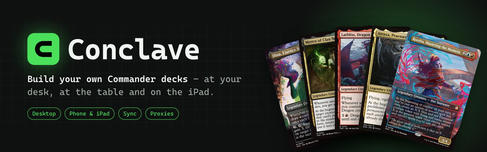
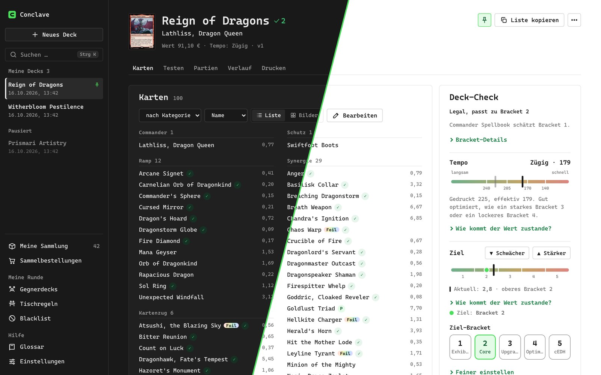
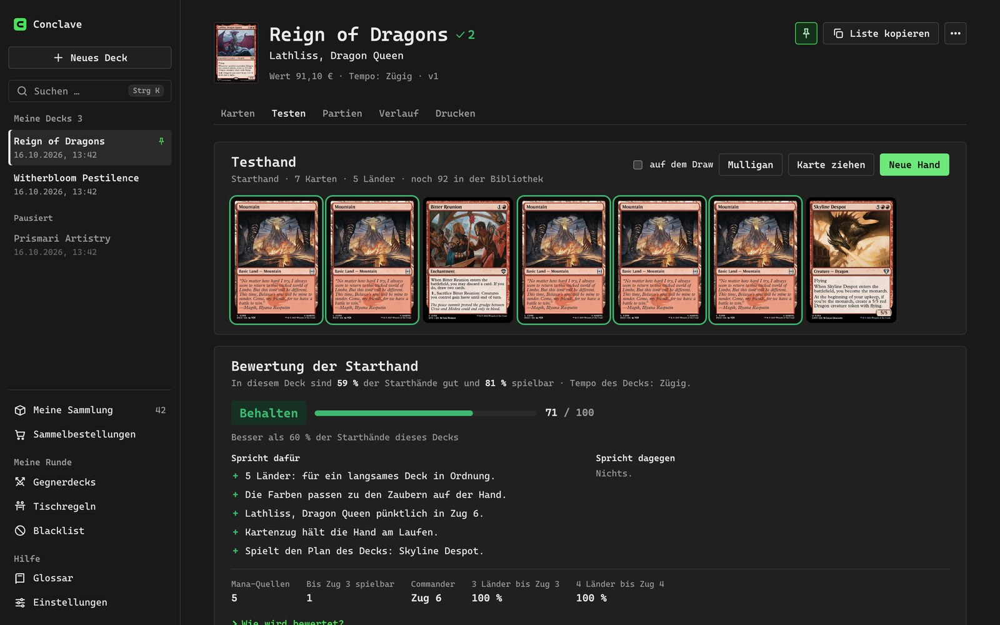
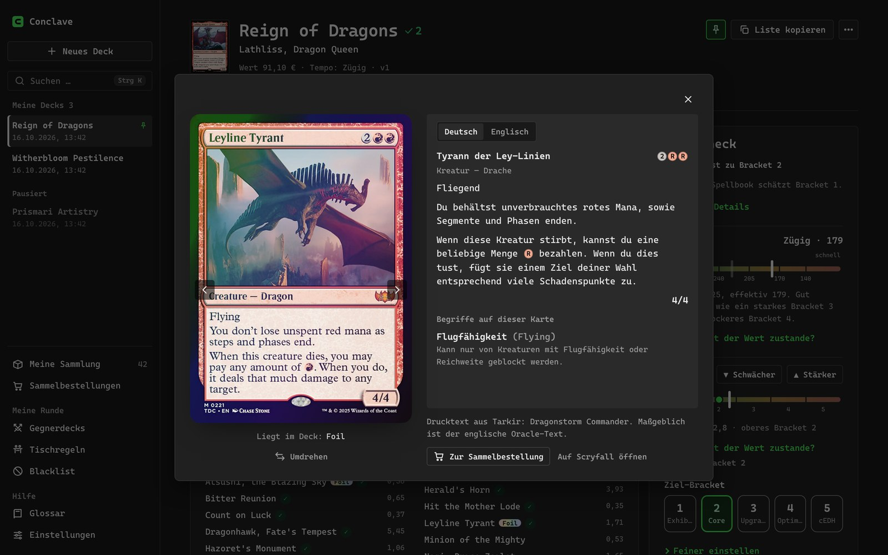
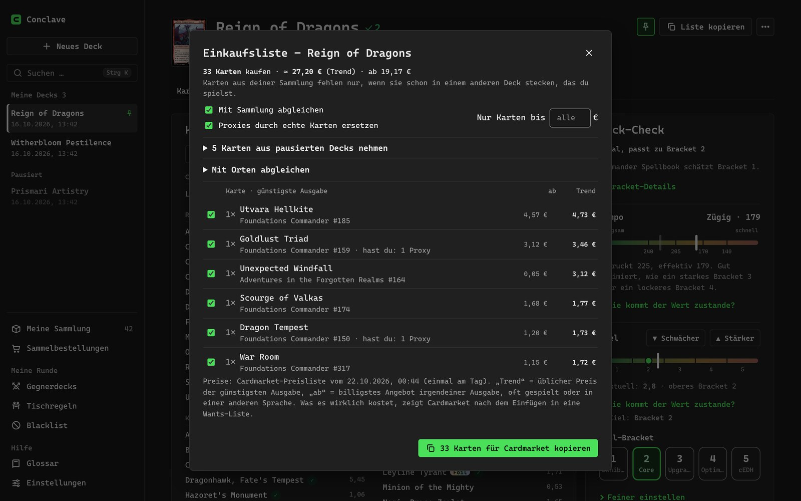
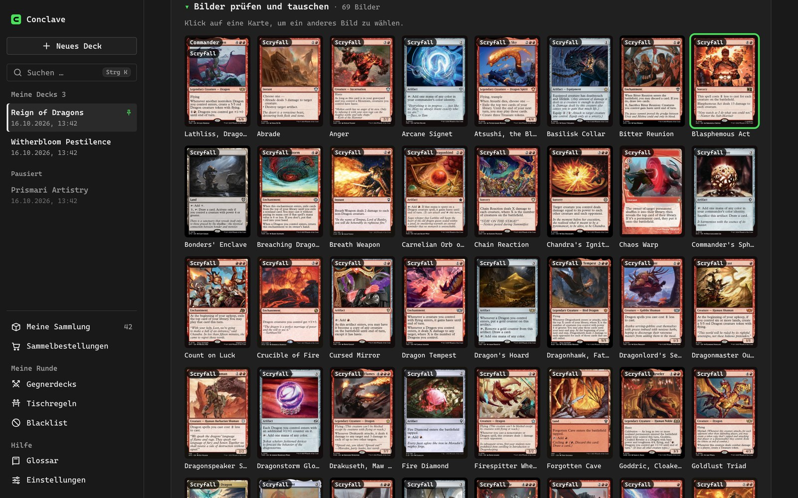
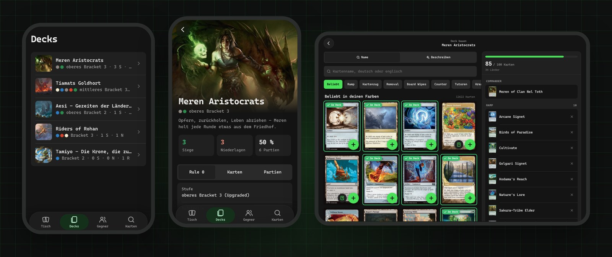

<p align="center">
  <picture>
    <source media="(prefers-color-scheme: light)" srcset="docs/images/banner-light.jpg">
    
  </picture>
</p>

<p align="center">
  <a href="https://github.com/liehrdot/Conclave/releases/latest"></a>
  <a href="https://github.com/liehrdot/Conclave/actions/workflows/tests.yml"></a>
  <a href="https://github.com/liehrdot/Conclave/actions/workflows/codeql.yml"></a>
  <a href="https://sonarcloud.io/project/overview?id=liehrdot_Conclave"></a>
  <a href="SECURITY.md"></a>
  
</p>

# Conclave

**Conclave is my own Commander deckbuilder for Magic: The Gathering.** I build my decks myself, and Conclave
takes care of the boring parts: it looks up cards, checks the rules and the power level, keeps every version
of a deck, lets me draw test hands, prints proxies and keeps my PC, phone and iPad in sync.

## Why this exists

Conclave is my personal experiment: **how far can vibe coding go?** I describe what I want in plain words,
[Claude Code](https://claude.com/claude-code) writes the code, and I try it out at my own table and say what
to change. Almost every line in this repository was written that way, from the first deck import to the
Windows app, the phone app and the sync server.

The funny twist: the app itself has no AI deck advice. That was on purpose. The thinking about which cards go
into a deck stays with me; the app only gives me the facts I need for it.

> This is a hobby project. It is built for my playgroup and me, it changes often, and the app speaks German.

## On the PC



- **Start a deck however you like:** pick a commander and add cards yourself, paste a link from Archidekt and
  others, paste a list, or start from an official precon. For Moxfield, the app opens a real Moxfield window
  where you log in, and one click brings the deck over.
- **Drag cards in from scryfall.com:** drop a card from the browser into the deck, or onto the
  "Vielleicht" (maybe) list for cards you are still unsure about.
- **Know where your deck stands:** a deck check shows if it is legal, which bracket it fits and what is
  missing, like ramp, card draw or removal. House rules and a personal blacklist are checked too.
- **Tempo:** next to the bracket, Conclave rates how fast a deck is from its total mana value. Cost reducers,
  convoke and cheap combos count, and it explains how it got the number.
- **Pin and pause decks:** pin your favourites to the top in your own order, and put decks you don't play
  right now aside, so their cards are free for other decks.
- **Every change is a version:** go back to any older state, compare two versions or copy a deck.

<table>
  <tr>
    <td width="50%">
      <picture>
        <source media="(prefers-color-scheme: light)" srcset="docs/images/desktop-test-light.jpg">
        
      </picture>
      <p align="center"><sub>Test hands, rated: keep, borderline or mulligan</sub></p>
    </td>
    <td width="50%">
      <picture>
        <source media="(prefers-color-scheme: light)" srcset="docs/images/desktop-cardview-light.jpg">
        
      </picture>
      <p align="center"><sub>Your own copies in the deck, foils included</sub></p>
    </td>
  </tr>
  <tr>
    <td width="50%">
      <picture>
        <source media="(prefers-color-scheme: light)" srcset="docs/images/desktop-buy-light.jpg">
        
      </picture>
      <p align="center"><sub>Shopping list with Cardmarket prices</sub></p>
    </td>
    <td width="50%">
      <picture>
        <source media="(prefers-color-scheme: light)" srcset="docs/images/desktop-print-light.jpg">
        
      </picture>
      <p align="center"><sub>Proxy printing with your own choice of art</sub></p>
    </td>
  </tr>
</table>

- **Test it before you sleeve it:** draw sample hands, see the odds for your land drops, and let the app
  rate each opening hand with the reasons for and against keeping it. No AI, just maths and rules of thumb.
- **Your collection, everywhere:** scan cards with the phone, import lists from ManaBox, Moxfield or Archidekt,
  and say where each copy lives (a deck, a binder, the bulk box). The deck view then shows your own copies
  with their printing, a foil shimmer, a 3D card view and their value.
- **Buy what you are missing:** a shopping list with Cardmarket prices that knows what is already in your
  collection, in a paused deck or in a box.
- **Print proxies:** pick the art for every card, print sheets at home as a PDF, or send the order to
  MakePlayingCards through MPC Autofill. An optional local upscaler makes old scans sharp.
- **Keep track of the table:** log games, remember the decks your friends play and what helps against them,
  and show a "Rule 0" summary of your deck before the game.
- **Updates by itself:** the Windows app installs new versions with one click and shows the progress.
  Brave? Turn on preview versions and get every change the day it is made.

## At the table and on the iPad

<picture>
  <source media="(prefers-color-scheme: light)" srcset="docs/images/mobile-light.jpg">
  
</picture>

The phone app runs in the browser and installs to the home screen, so there is no app store involved. It is
made for the game night:

- **Log a game in seconds**, with the opponents' commanders and how the game was decided.
- **Round helper:** counts life, commander damage, poison and turns during the game.
- **Scan your cards:** point the camera at a card and it lands in your collection, as original or proxy,
  foil or not, in any language.
- **Look up cards in German**, with mana symbols and double-faced cards you can flip, or **describe a card**
  ("a green creature that ramps") and get matching cards. This card search is the one small AI feature I
  asked for.
- **Build decks on the iPad** with a big card grid and the deck right next to it.

Every device keeps all its data and works without a connection; a small sync server only passes the changes
along.

## Conclave Cloud

Don't want to run a server? **Conclave Cloud** is a sync server I run for you, so your decks, games and
collection travel between PC, phone and iPad without any setup.

It is invite only for now. Ask for access on the **[Conclave Cloud page](https://conclave-cloud.duckdns.org/start/)**
("Zugang anfragen"): leave your name and how we know each other, and I'll let you in by hand. With an invite
code you create your sync on the same page and connect your first device with a QR code.

Prefer to host it yourself? The sync server runs on your own machine too, see the
[technical docs](docs/technik.md#sync-zwischen-geräten-eigener-server).

## Thanks

The flat green look and parts of the workflow come from the fork of my colleague Felix. Card data comes from
[Scryfall](https://scryfall.com), recommendations from [EDHREC](https://edhrec.com) and combos and bracket
estimates from [Commander Spellbook](https://commanderspellbook.com).

Conclave is unofficial fan content. Magic: The Gathering and all card images belong to Wizards of the Coast.
Artists of the card art we use on social media are listed in [CREDITS.md](CREDITS.md).

## The technical side

Want to run it yourself, set up the sync server or look under the hood? All of that lives in
**[docs/technik.md](docs/technik.md)** (German): installation, the Windows app, the sync server, the phone app,
printing, configuration and development.

The short version for developers:

```bash
git clone https://github.com/liehrdot/Conclave.git
cd Conclave
uv sync --all-extras
uv run mtg-gui     # opens on http://127.0.0.1:8765
uv run pytest      # all tests, offline
```

The Windows app is on the [releases page](https://github.com/liehrdot/Conclave/releases/latest).
